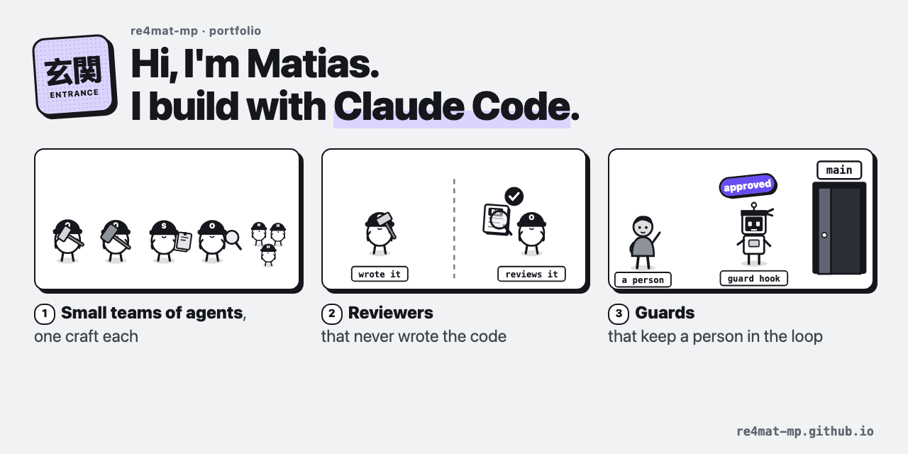

### Hi, I'm Matias 👋

I build with Claude Code: small teams of agents with one craft each, reviewers that never wrote the code they
review, and guards that keep a person in the loop before anything ships.

I came to this from operations, not engineering, so I learned most of it by getting it wrong first. I write down
what I learn, so you can skip some of the mistakes. Every project here opens: each one has a page you can click
through, and a README a person or an AI can read.

**The pieces, in order**

1. 🧭 [**claude-setup-guide**](https://github.com/re4mat-mp/claude-setup-guide): my Claude Code setup and the habits
   behind it. Agents, reviewers, guard hooks, and a memory that loads whole.
   [Open it](https://re4mat-mp.github.io/claude-setup-guide/).
2. 🏭 **The factory**: how I run the big jobs. A script cuts the work, agents read in parallel, code checks every
   answer. [See it run](https://re4mat-mp.github.io/claude-setup-guide/factory/).

**▶ [Open the portfolio](https://re4mat-mp.github.io/)**: every project as a page you can click through.
